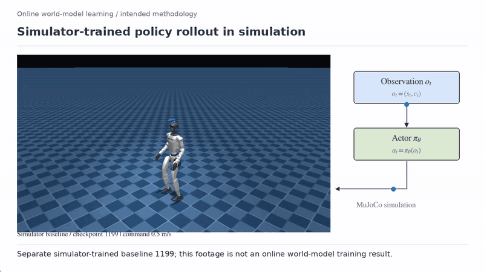
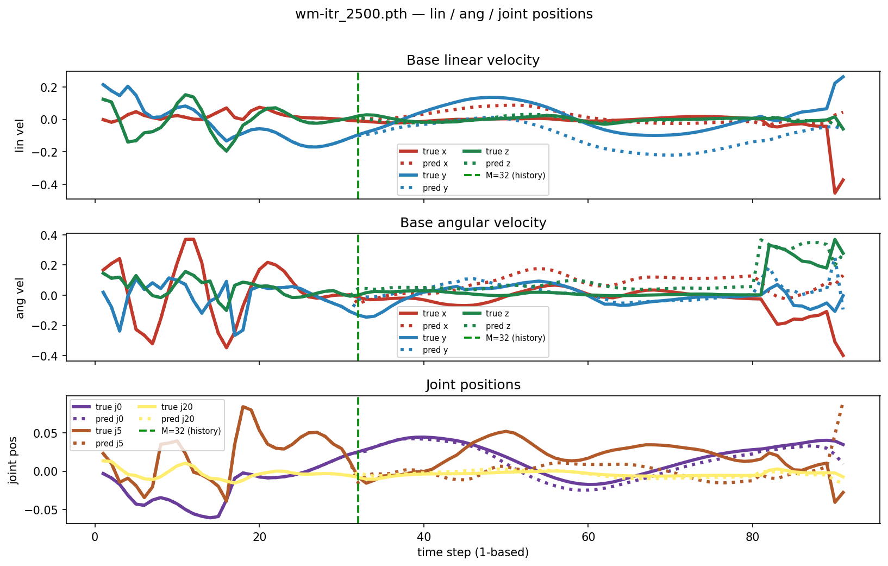
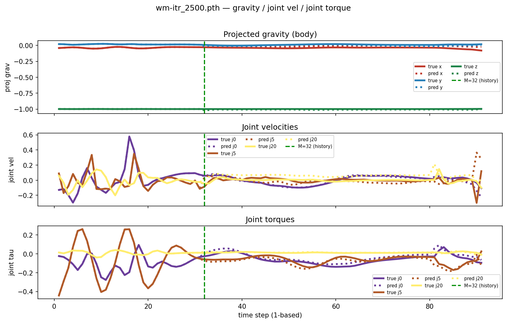
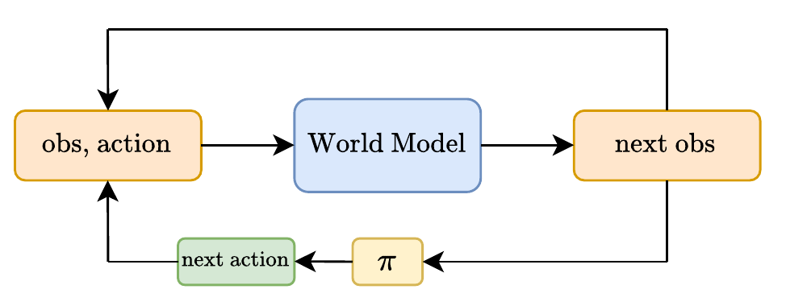
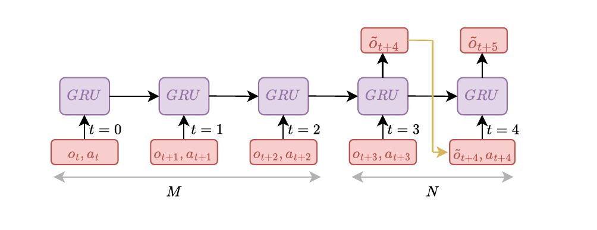
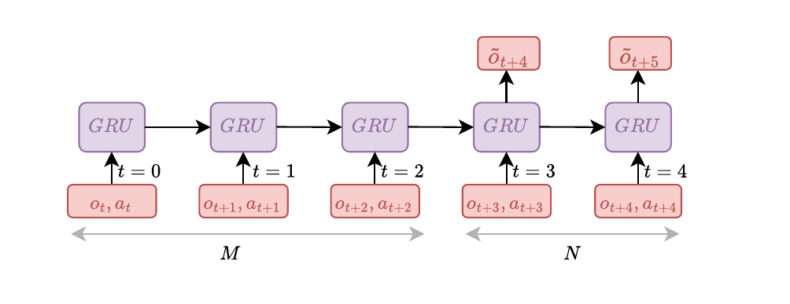

# Online World Models for Unitree G1

An experimental MuJoCo/MJLab pipeline that learns a recurrent dynamics model from
policy rollouts and trains PPO using imagined transitions. This repository explores
online model learning, recurrent state prediction, and policy optimization in a
learned simulator.

[Read the OCRL report: Learning to Imagine: Autoregressive Dynamics for Long-Horizon Policy Learning](docs/report/OCRL_Report.pdf).

**Status:** training, checkpoint evaluation, video capture, and plotting run locally.
The current online world-model checkpoints do not yet demonstrate reliable velocity-command tracking.
The earlier 7030 checkpoint stays upright but mostly stands still; the newer 3710
checkpoint is unstable in the measured evaluation. See [validation and limitations](docs/validation.md).

## Pipeline

[](docs/assets/videos/pipeline.mp4?raw=true)

**[Open or download the full 57-second pipeline video](docs/assets/videos/pipeline.mp4?raw=true)** —
opens with the simulator baseline rollout, then shows transition collection and
replay, world-model updates, simulator PPO before
warm-start ends, a switch to world-model PPO, and repeated optimization. Captioned, with actual rollout
footage from a separately trained simulator baseline. The diagram shows the intended
sequence; the current warm-start implementation fits the world model without
initial simulator PPO updates.

[Baseline 1199 locomotion recording](docs/assets/videos/baseline-1199-rollout.mp4?raw=true):
20 seconds without a fall at seed 42, with mean forward velocity 0.271 m/s against
a 0.5 m/s command (RMSE 0.232 m/s). This baseline is distinct from the online
world-model checkpoints below. [Recorded data](docs/results/baseline-1199).

[Watch 7030 recording](docs/assets/videos/7030-rollout.mp4?raw=true) ·
[Watch 3710 failure recording](docs/assets/videos/3710-rollout.mp4?raw=true) ·
[Evaluation data and provenance](docs/results)

| Diagnostic | Earlier run: 7030 | Latest run: 3710 |
|---|---:|---:|
| Evaluation duration | 20 s | 20 s |
| Non-timeout episode endings | 0 | 36 |
| Forward velocity RMSE | 0.499 m/s | 1.068 m/s |
| Lateral velocity RMSE | 0.008 m/s | 1.162 m/s |
| Yaw-rate RMSE | 0.027 rad/s | 13.615 rad/s |
| Normalized forecast RMSE, one window | 0.069 | 3.259 |

Both runs use the same command, seed, observation convention, and evaluation settings.
These are single-seed diagnostics, not baseline comparisons. Forecast error is measured
on each policy's own trajectory; the values do not isolate model quality from behavior.

## Results

The supplied figures below show predictions from `wm-itr_2500.pth`. Solid lines
show ground truth, dotted lines show predictions, and the green boundary marks
the end of the 32-step history window. These report figures correspond to a
separate experiment from the 7030/3710 diagnostics above.



*Base motion and joint-position predictions.*



*Projected gravity, joint-velocity, and joint-torque predictions.*

## How it works



*Figure 2 from the [OCRL report](docs/report/OCRL_Report.pdf): the world model predicts the
next observation, and the policy supplies the next action for continued rollout.*

### Recurrent training



*Dual-autoregressive training: observed state-action history builds the hidden
state over M steps; predicted observations feed subsequent forecast steps over N.*
[Original diagram PDF](docs/assets/architecture/autoreg_gru.drawio-1.pdf).



*Teacher-forcing comparison: ground-truth observations are supplied at each step.*
[Original diagram PDF](docs/assets/architecture/teacher_forcing_gru.drawio-1.pdf).

The dynamics model consumes a 96-dimensional robot state and 29 joint targets.
A two-layer GRU with 256 hidden units predicts state changes through a residual
mean head and a learned uncertainty head. Policy and value networks use three
256-unit hidden layers. The policy input contains 67 normalized state features,
29 previous-action features, and three velocity commands.

The state consists of world-frame base linear/angular velocities, projected gravity,
joint positions, joint velocities, and actuator forces. There is no camera encoder
in this implementation. The newly recorded diagnostic forecasts use deterministic
mean predictions; the supplied report figures retain their original experiment
settings. Training and imagination behavior are described in the code and validation notes.

## Get started

Follow [setup.md](docs/setup.md) for the pinned environment and complete commands.
Historical checkpoint paths and checksums are in [docs/checkpoints.json](docs/checkpoints.json).
Checkpoint downloads have not yet been published; the local files are excluded from Git.

```bash
# Evaluate the latest local checkpoint and record a video.
MUJOCO_GL=egl python scripts/evaluate.py --steps 1000 --command 0.5 0 0 \
  --prediction-horizon 8 --video --output runs/eval-3710
python scripts/plot_results.py runs/eval-3710

# Train a fresh experiment; use a unique output directory.
python scripts/train.py --num-envs 256 --iterations 1000 --output runs/train-01

# Focused CPU checks.
python -m unittest discover -s tests -p 'test_core.py' -v
```

Use the explicit earlier-checkpoint commands in [setup.md](docs/setup.md) to reproduce the
7030 recording. Checkpoint initialization restores weights and optimizer state but
is not an exact resume of the simulator and replay history.

## Repository guide

```text
configs/             Default experiment configuration
src/ocrl/            Installable model, training, storage, and CLI code
scripts/             Training, evaluation, plotting, and diagnostic commands
tests/               Automated tests
docs/                Setup, validation, report, figures, videos, and results
artifacts/           Local historical checkpoints (ignored)
runs/                Generated experiments (ignored)
```

| Path | Purpose |
|---|---|
| `scripts/train.py` | Online collection, world-model updates, and PPO training |
| `scripts/evaluate.py` | Shared headless/viewer evaluation, metrics, predictions, video |
| `src/ocrl/observations.py` | Observation adapter and configuration/checksum helpers |
| `src/ocrl/models/world_model.py` | Residual GRU dynamics model |
| `src/ocrl/training/` | Sequence training and imagined dynamics/rewards |
| `src/ocrl/storage/replay_buffer.py` | Episode-aware sequence sampling |
| `scripts/` | Environment/checkpoint checks and plotting |
| `docs/` | Results, provenance, limitations, and checkpoint manifest |

The obsolete offline-data pipeline, copied dependency modifications, and baseline
submodule have been retired. `configs/default.json` holds the default configuration.
Historical local checkpoints live under ignored `artifacts/historical/`; new
experiments write to ignored `runs/`. Install the package with `pip install -e .`
before running the scripts.

## Acknowledgments

This project is inspired by **Chenhao Li, Andreas Krause, and Marco Hutter,
[Robotic World Model: A Neural Network Simulator for Robust Policy Optimization
in Robotics](https://arxiv.org/abs/2501.10100)** (2025). We acknowledge their work on
learning robotic dynamics and optimizing policies through imagined experience.
See the [official implementation](https://github.com/leggedrobotics/robotic_world_model).
This repository is an independent experiment and does not claim to reproduce the
paper's results.

```bibtex
@article{li2025robotic,
  title={Robotic World Model: A Neural Network Simulator for Robust Policy Optimization in Robotics},
  author={Li, Chenhao and Krause, Andreas and Hutter, Marco},
  journal={arXiv preprint arXiv:2501.10100},
  year={2025}
}
```

Thanks also to the maintainers of MJLab, MuJoCo/MuJoCo Warp, RSL-RL, PyTorch, and
the Unitree robot assets and baseline tooling used in these experiments.

## License

The project license is undecided. Third-party dependencies and adapted code retain
their respective licenses; this README does not relicense them.
